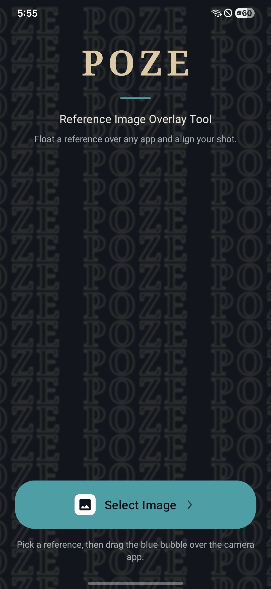
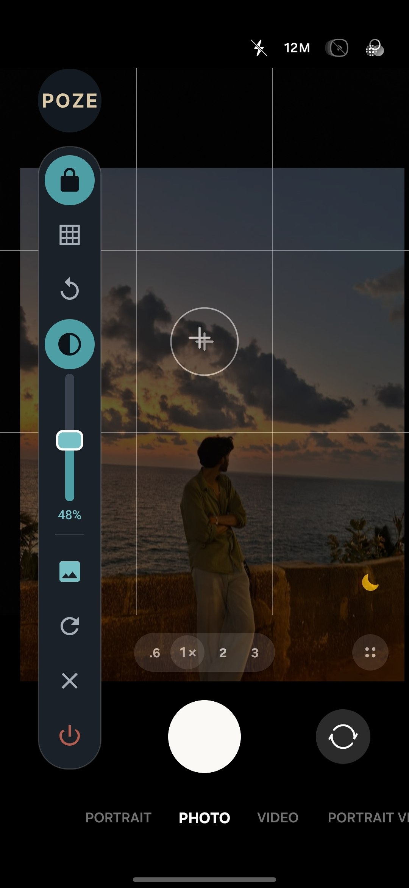
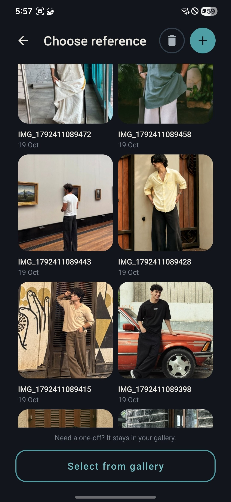

<div align="center">

# POZE

**Reference Image Overlay Tool for Android**

Float a reference photo over any app — usually the camera — and align your shot.

[](https://developer.android.com)
[](https://kotlinlang.org)
[](https://developer.android.com)
[](https://developer.android.com)
[]()
[]()

<br/>

[](../../releases/latest)

</div>

---

## Get the APK

**[Download POZE 1.0](../../releases/latest)** — signed release APK, 4.6 MB, no Play Store needed.

1. Open the release page on your phone and download `POZE-1.0.apk`
2. Allow the install when Android asks — *Settings → Apps → Special access → Install unknown apps*
3. Open POZE, grant **Display over other apps**, pick a reference, then tap the floating bubble

The APK is signed with the project's own release key, so later versions install straight over the top.

<br/>

## What it is

POZE draws a saved photo on top of everything else on your screen, so you can line a subject up against a reference you already liked. Pick the image once, then drag a small floating bubble wherever it is comfortable and the tool bar opens right out of it.

It is a single-purpose tool: no accounts, no network calls, no ads, no analytics. Every image stays in the app's own storage.

<br/>

<div align="center">

| Home | Over the camera | Reference library |
|:---:|:---:|:---:|
|  |  |  |
| Pick a reference | Lock, grid, rotate, opacity | Saved references, one tap away |

</div>

<br/>

## Features

- **Floating bubble** over any app — drag it anywhere, it remembers where you left it
- **Vertical tool bar** that grows down out of the bubble, in the same column, so it never covers what you are framing
- **Reference library** — save images once and reopen them in one tap
- **Pinch to zoom, drag to move** and a **lock** to freeze the image so you can't nudge it by accident
- **Opacity slider** with a live percentage readout, inline in the bar
- **Composition grid** for the rule of thirds
- **Reset** and **90° rotate** for the overlay
- **Stays put on rotation** — the reference is glued to the device: same physical spot, size and angle when the screen turns
- **Deep Calm theme** — flat, muted slate with a single aqua accent and warm sand; zero gradients
- **Respects reduced motion** — every animation is skipped when the system animation scale is off

## How it works

POZE is an Android app (Kotlin, XML views, Material Components, view binding) built around a **foreground service** that owns three independent overlay windows:

| Window | Type | Role |
|---|---|---|
| `ReferenceImageView` | `TYPE_APPLICATION_OVERLAY` | The reference image, drawn through a `Matrix` |
| `GridOverlayView` | `TYPE_APPLICATION_OVERLAY` | Non-touchable rule-of-thirds grid |
| Bubble + tool bar | `TYPE_APPLICATION_OVERLAY` | The floating bubble and the vertical pill |

State lives in a single `OverlayState` object passed through the service, so tools read and write the same source of truth.

A few details worth a look:

- **`ReferenceImageView`** — draws the bitmap with a cached `fitScale` so the image keeps its physical size across window resizes, and counter-rotates the canvas by the display rotation so the reference stays glued to the device instead of turning with the screen.
- **`RectSlider`** — one custom slider used twice: horizontally in the legacy panel layout and vertically inline in the tool bar. Fill, thumb and touch mapping flip with `isVertical`.
- **`OverlayService.positionToolBar()`** — keeps the bar in the bubble's column directly underneath it and only flips it above the bubble when there is genuinely no room below, so it can never run off screen or cover the bubble.
- **`PozeMotion`** — one place that decides whether motion is allowed at all, read from `Settings.Global.ANIMATOR_DURATION_SCALE`.
- **`Insets`** — edge-to-edge helpers, required because `targetSdk 36` forces edge-to-edge.

## Design

The UI was locked in HTML before a single Android view was touched. The working previews are kept in [`design/`](design):

- `home-bg-preview.html` — the animated POZE tile wallpaper
- `tool-bar-preview.html` — the original horizontal tool bar
- `tool-bar-vertical-preview.html` — the vertical bar, all animation and slider variants
- `icon-preview.html`, `preview.html`, `tool-card-options.html` — icon and card exploration
- `uimax/*.svg` — the full design sheet: tokens, every screen and state, components and motion

Palette, for reference:

```
base      #141A22      surface   #1E252E      icon bg   #141A22
accent    #4E9EA6      accent-2  #3E848B      soft      #77C0C6
sand      #DCC9A8      on-surface #ECE9E2     dim       #A6AFB7
stop red  #B85B4F      divider   #1FFFFFFF    menu bg   #1B2129
```

Radii: panel 22, dialog 24, row 16, control 12, pill 26. Motion: 150 ms fast, 220 ms base, 300 ms slow, decelerate.

## Build

**Requirements:** JDK 17, Android SDK 36, an Android device or emulator on API 26+.

```bash
./gradlew :app:assembleDebug
```

The debug APK lands in `app/build/outputs/apk/debug/app-debug.apk`.

### Release signing

The release keystore is **not** in this repository. Release signing reads from `local.properties` (git-ignored) or from environment variables:

```properties
poze.storeFile=../your-release.keystore
poze.storePassword=...
poze.keyAlias=...
poze.keyPassword=...
```

Environment variable equivalents `POZE_STORE_FILE`, `POZE_STORE_PASSWORD`, `POZE_KEY_ALIAS`, `POZE_KEY_PASSWORD` are read too, which is the path CI should take. See [`local.properties.example`](local.properties.example). Without it you still get debug builds and an unsigned release build.

## Permissions

| Permission | Why |
|---|---|
| `SYSTEM_ALERT_WINDOW` | Draw the reference over other apps — the whole point |
| `FOREGROUND_SERVICE`, `FOREGROUND_SERVICE_SPECIAL_USE` | Keep the overlay alive with a visible notification |

No storage, location, camera, network or contacts permission is requested. POZE never reads your camera feed — it draws on top of it.

## Project layout

```
app/src/main/java/com/poze/app/
  MainActivity.kt          permission hand-off + launch
  GalleryActivity.kt       saved reference library, multi-select import
  overlay/
    OverlayService.kt      foreground service, all three windows, tool bar logic
    ReferenceImageView.kt  matrix transform, zoom, rotate, locked-to-device rotation
    RectSlider.kt          horizontal / vertical opacity slider
    GridOverlayView.kt     rule-of-thirds grid
    OverlayState.kt        single source of truth
  ui/
    WaveBackgroundView.kt  animated POZE tile wallpaper
    PozeMotion.kt          motion token + reduced-motion check
    Insets.kt              edge-to-edge helpers
    PozeDialog.kt          styled dialogs
    PozeToast.kt           styled toasts
design/                    HTML design previews (locked before implementation)
screenshots/               app screenshots used in this readme
```

## Status and roadmap

Working and tested on device:

- [x] Reference library with multi-select import
- [x] Floating bubble with drag, memory of position
- [x] Vertical tool bar: lock, grid, rotate, opacity, gallery, reset, close, stop
- [x] Inline vertical opacity slider
- [x] Device-locked rotation behaviour
- [x] Deep Calm theme across home, gallery, dialog, toast and overlay

Next:

- [ ] Landscape layout pass for the tool bar
- [ ] Per-reference notes and quick labels
- [ ] Export the composed shot
- [ ] Optional short onboarding on first launch
- [ ] Instrumented tests for the service and custom views

## Known notes

- The gallery screenshot hint on the home screen still says "drag the blue bubble" while the bubble is dark slate — copy fix pending.
- The reference is deliberately pinned to the device on rotation, so turning the phone does not turn the reference with it. Reset re-centres it if you want to re-frame.

## Author

**DILJITH** — B.Tech CSE undergrad
GitHub: [@diljithprdev](https://github.com/diljithprdev)

Built as a personal tool first: I wanted to line up shots against photos I had already taken, and nothing on the Play Store did it without ads, accounts or a paywall.

## License

No license has been chosen yet, so all rights are reserved for now. Open an issue if you would like to use any part of it.
